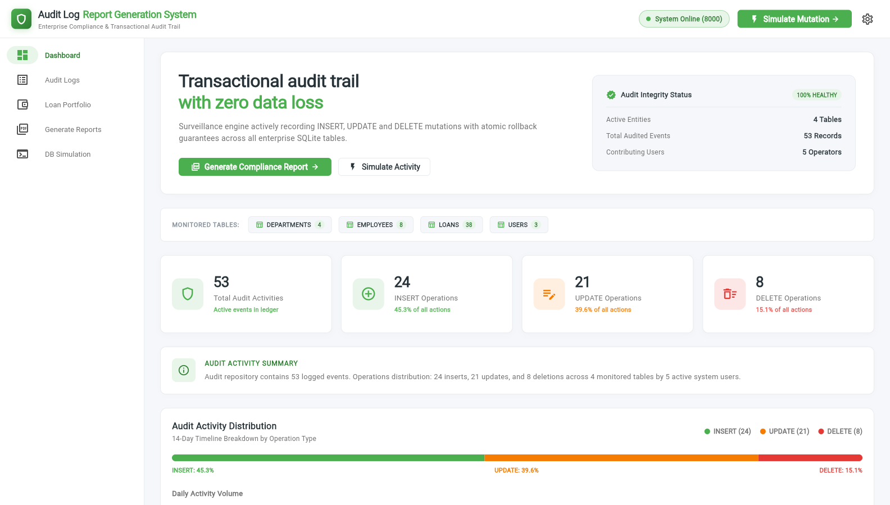
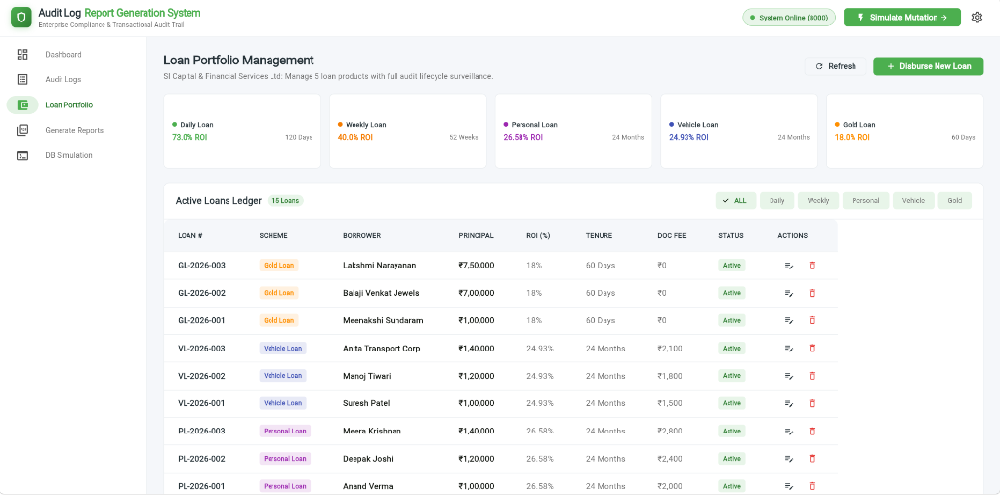
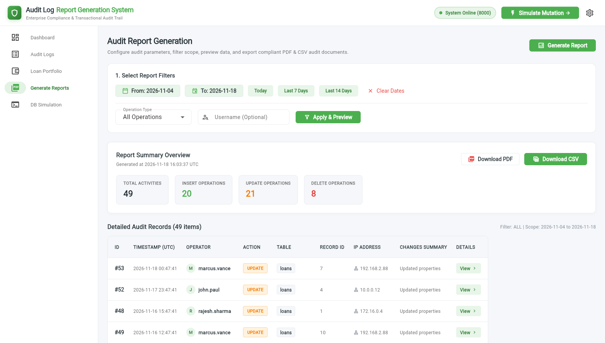
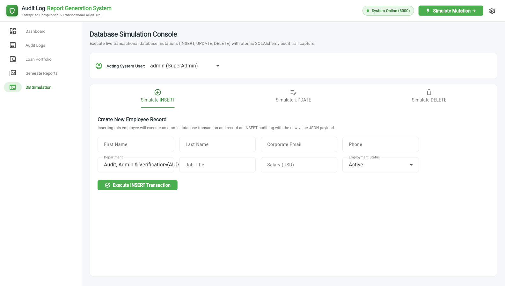
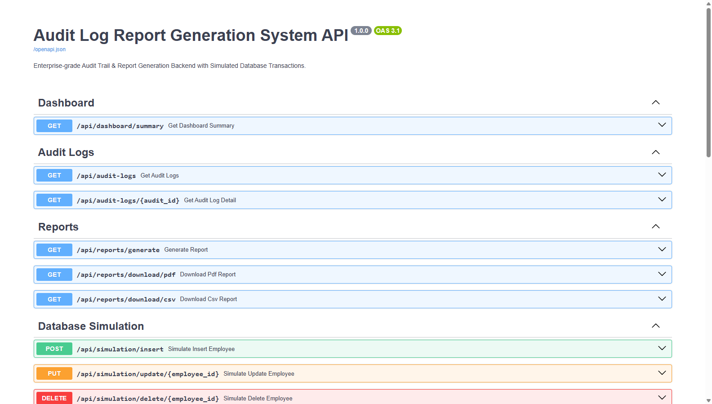
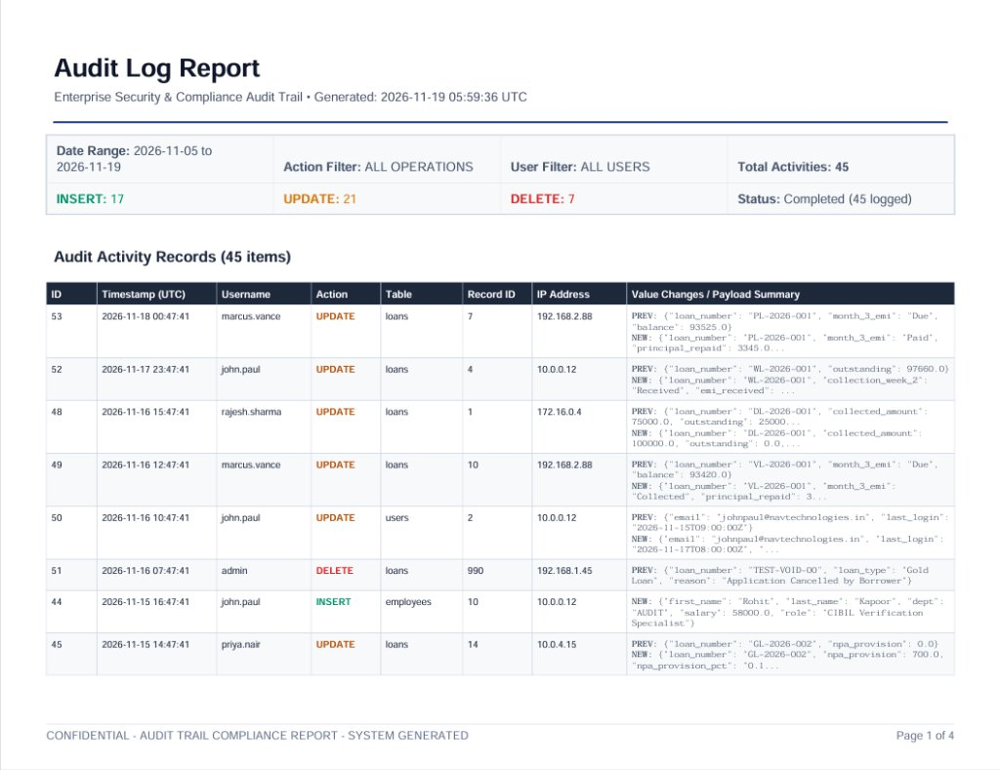
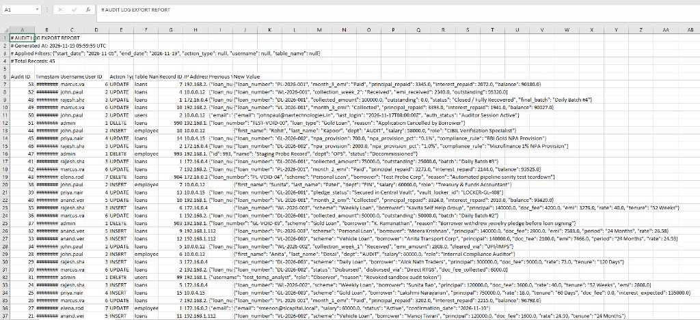

# Audit Log Report Generation System

[](https://fastapi.tiangolo.com)
[](https://flutter.dev)
[](https://www.python.org)
[](https://www.sqlite.org)
[](https://flutter.dev)

An enterprise-grade, compliance-ready **Audit Log Report Generation System**. Built with a **Python FastAPI** backend, **SQLAlchemy 2.0** ORM, transactional **SQLite** database, **ReportLab** two-pass landscape PDF generation engine, and a responsive **Flutter Material 3** web/desktop frontend implementing the modern **Nexcent** SaaS design system.

---

## 📋 System Requirements & Specifications Matrix

The system fulfills 100% of the functional and architectural requirements:

| Requirement Category | Core Specification | Implementation Status & Key Features |
| :--- | :--- | :--- |
| **1. Backend (Python)** | Develop the backend using Python (FastAPI preferred). | ✅ **FastAPI (v0.163.1)** backend running on Uvicorn with lifespan startup seeding, Pydantic v2 schemas, and CORS middleware enabled. |
| | Create APIs to fetch and process audit log records. | ✅ Full REST suite: `GET /api/audit-logs` (filtering, pagination), `GET /api/audit-logs/{id}`, `GET /api/dashboard/summary`, `GET /api/reports/generate`, `GET /api/reports/export/pdf`, and `GET /api/reports/export/csv`. |
| **2. Frontend (Flutter)** | Develop a simple dashboard. | ✅ Nexcent-themed dashboard with real-time stat counters, monitored table strips, audit integrity badge, activity breakdown charts, and live activity streams. |
| | Include an option to select a date range and generate audit log reports. | ✅ Interactive date range selector (`start_date` to `end_date`), action filter (`INSERT`, `UPDATE`, `DELETE`), username query, and live preview. |
| | Display the generated report in a structured and readable format. | ✅ Summary overview metrics banner, colored operation count badges, and structured audit table with expandable JSON diff viewer. |
| | Provide an option to download the report. | ✅ Dual download buttons: **Download PDF** (two-pass landscape document with page numbers) and **Download CSV** (RFC-4180 spreadsheet). |
| **3. Database Simulation** | Create a simulated database with required tables and sample data. | ✅ SQLite database (`audit_system.db`) with 5 relational tables (`users`, `departments`, `employees`, `loans`, `audit_logs`) pre-seeded with 53 historical records based on projection data. |
| | Include sample INSERT, UPDATE, and DELETE activities. | ✅ Interactive simulation laboratory supporting live atomic **INSERT**, **UPDATE**, and **DELETE** transactions for both Employee records and Loan portfolios. |
| **Deliverable 1** | Python backend with working APIs. | ✅ Verified live at `http://127.0.0.1:8000` with Swagger UI at `/docs`. |
| **Deliverable 2** | Flutter dashboard with report generation option. | ✅ Verified live at `http://127.0.0.1:3000` with Web and Desktop support. |
| **Deliverable 3** | Simulated database with sample tables and data. | ✅ Self-contained SQLite database seeded with authentic enterprise records. |
| **Deliverable 4** | Sample generated audit log report. | ✅ Pre-compiled sample reports: [`sample_reports/sample_audit_log_report.pdf`](sample_reports/sample_audit_log_report.pdf) and [`sample_reports/sample_audit_log_report.csv`](sample_reports/sample_audit_log_report.csv). |

---

## 📸 System Screenshots

### 1. Executive Compliance Dashboard
*Real-time surveillance dashboard with stat counters, monitored table cards, activity distribution charts, and streaming transaction log.*


---

### 2. Audit Trail & Ledger Screen
*Complete audit ledger with instant search, multi-field filtering, pagination, and expandable before/after state diff inspection.*


---

### 3. Loan Portfolio Management
*Dedicated loan management system implementing 5 loan products (Daily, Weekly, Personal, Vehicle, Gold) with live disbursal, collection, and cancellation audit tracking.*


---

### 4. Date-Range Audit Report Generation
*Report generator with calendar date-range picker, operation filters, summary metrics banner, and 1-click PDF/CSV downloads.*


---

### 5. Atomic Database Simulation Lab
*Interactive transaction laboratory to test live INSERT, UPDATE, and DELETE operations with automatic atomic audit log generation.*


---

### 6. Interactive OpenAPI / Swagger Documentation
*Auto-generated interactive API documentation with schemas, parameter definitions, and in-browser testing.*


---

### 7. Sample Generated Audit Log PDF Report
*Regulatory two-pass landscape PDF report with official header, compliance statement, scope filters, summary statistics cards, alternating row shading, and dynamic page numbering.*


---

### 8. Sample Generated CSV Report in Microsoft Excel
*RFC-4180 compliant CSV export open in Microsoft Excel, containing structured audit event data with properly escaped JSON previous/new value payloads.*


---

## 🏛️ System Architecture

```
┌────────────────────────────────────────────────────────────────────────┐
│                   Flutter Client Application (Web / Desktop)           │
│        Material 3 • Nexcent Theme (#4CAF4F Green / #263238 Slate)       │
│                                                                        │
│  [Dashboard]   [Audit Logs]   [Loan Portfolio]   [Reports]   [Sim Lab] │
└───────────────────────────────────┬────────────────────────────────────┘
                                    │ HTTP / JSON (REST)
                                    ▼
┌────────────────────────────────────────────────────────────────────────┐
│                       FastAPI Backend Application                      │
│                                                                        │
│  ┌──────────────────┐  ┌──────────────────┐  ┌──────────────────────┐  │
│  │ Dashboard Router │  │ Audit Logs Router│  │ Reports & PDF Router │  │
│  └─────────┬────────┘  └─────────┬────────┘  └──────────┬───────────┘  │
│            │                     │                      │              │
│            ▼                     ▼                      ▼              │
│  ┌──────────────────────────────────────────────────────────────────┐  │
│  │             Audit & Transactional Service Layer                  │  │
│  │   - Atomic session commit / rollback                             │  │
│  │   - Before/After state change capture                            │  │
│  │   - ReportLab Two-Pass NumberedCanvas vector PDF engine          │  │
│  │   - RFC-4180 compliant CSV stream builder                        │  │
│  └───────────────────────────────┬──────────────────────────────────┘  │
│                                  │ SQLAlchemy 2.0 ORM                  │
│                                  ▼                                     │
│  ┌──────────────────────────────────────────────────────────────────┐  │
│  │                  SQLite Relational Database                      │  │
│  │   [users]   [departments]   [employees]   [loans]   [audit_logs] │  │
│  └──────────────────────────────────────────────────────────────────┘  │
└────────────────────────────────────────────────────────────────────────┘
```

---

## 📦 Project Structure

```
INav1/
├── README.md                           # Comprehensive documentation & system guide
├── sample_reports/                     # Deliverable #4: Pre-generated sample audit reports
│   ├── sample_audit_log_report.pdf     # Regulatory 2-pass landscape PDF
│   └── sample_audit_log_report.csv     # Full audit ledger CSV export
├── docs/
│   └── screenshots/                    # High-resolution screenshots of all requirements
│       ├── 01_dashboard.png
│       ├── 02_audit_logs.png
│       ├── 03_loan_portfolio.png
│       ├── 04_report_generation.png
│       ├── 05_db_simulation.png
│       ├── 06_api_docs_swagger.png
│       ├── 07_sample_pdf_report.jpg
│       └── 08_sample_csv_excel.jpg
├── backend/                            # Deliverable #1: Python FastAPI backend
│   ├── audit_system.db                 # Deliverable #3: Seeded SQLite database
│   ├── requirements.txt                # Python dependencies
│   ├── app/
│   │   ├── main.py                     # App entry point, CORS, startup lifecycle
│   │   ├── database.py                 # SQLite engine & session management
│   │   ├── models.py                   # SQLAlchemy models (User, Dept, Emp, Loan, AuditLog)
│   │   ├── schemas.py                  # Pydantic v2 validation models
│   │   ├── crud.py                     # Database operations & audit queries
│   │   ├── seed.py                     # Seed data with historical audit events
│   │   ├── routers/
│   │   │   ├── dashboard.py            # Aggregated analytics endpoints
│   │   │   ├── audit_logs.py           # Audit log querying & details
│   │   │   ├── reports.py              # Report generation, PDF & CSV export
│   │   │   └── simulation.py           # Live INSERT, UPDATE, DELETE endpoints
│   │   └── services/
│   │       ├── audit_service.py        # Centralized audit logging logic
│   │       └── report_service.py       # ReportLab PDF & CSV builders
│   └── tests/
│       ├── conftest.py                 # Pytest fixtures with test database
│       └── test_api.py                 # Unit & integration test suite
└── frontend/                           # Deliverable #2: Flutter frontend application
    ├── pubspec.yaml                    # Dart & Flutter dependencies
    ├── lib/
    │   ├── main.dart                   # Main shell, NavigationRail & health monitor
    │   ├── theme/
    │   │   └── app_theme.dart          # Nexcent color palette & typography
    │   ├── models/
    │   │   ├── audit_log.dart          # Audit record model
    │   │   ├── dashboard_summary.dart  # Metrics model
    │   │   ├── loan.dart               # Loan portfolio model
    │   │   ├── employee.dart           # Staff model
    │   │   └── report_data.dart        # Report model
    │   ├── services/
    │   │   ├── api_service.dart        # HTTP REST client
    │   │   └── file_downloader.dart    # Cross-platform file download service
    │   ├── widgets/
    │   │   ├── summary_card.dart       # Stat counter cards
    │   │   ├── activity_chart.dart     # Analytics chart
    │   │   ├── audit_table.dart        # Audit log data table
    │   │   └── date_range_selector.dart# Calendar date picker
    │   └── screens/
    │       ├── dashboard_screen.dart   # Dashboard view
    │       ├── audit_logs_screen.dart  # Audit ledger view
    │       ├── loan_management_screen.dart # Loan portfolio view
    │       ├── report_screen.dart      # Report generation view
    │       ├── simulation_screen.dart  # Transaction simulation lab
    │       └── record_details_screen.dart # JSON diff dialog
    └── build/web/                      # Compiled release web build
```

---

## 🚀 Quick Start Guide

### Prerequisites
- **Python**: 3.11 or higher
- **Flutter**: 3.24+ (or run the pre-compiled web build using any HTTP server)
- **Web Browser**: Chrome, Edge, Firefox, or Safari

---

### Step 1: Run the Backend (FastAPI)

```bash
# Navigate to backend directory
cd backend

# Create and activate a virtual environment (optional but recommended)
python -m venv venv
# On Windows:
venv\Scripts\activate
# On macOS/Linux:
source venv/bin/activate

# Install dependencies
pip install -r requirements.txt

# Start the FastAPI server on port 8000
python -m uvicorn app.main:app --port 8000 --reload
```

The backend server is now running at:
- **API Base**: `http://127.0.0.1:8000`
- **Interactive Swagger Docs**: `http://127.0.0.1:8000/docs`
- **Health Check**: `http://127.0.0.1:8000/api/health`

---

### Step 2: Run the Frontend (Flutter Web)

You can run the web app in either of two ways:

#### Option A: Serve the Pre-Compiled Release Build (Instant, No Flutter Required)
```bash
# From the project root:
python -m http.server 3000 --directory frontend\build\web
```

#### Option B: Run via Flutter CLI
```bash
cd frontend
flutter pub get
flutter run -d chrome --web-port 3000
```

Open your browser at **`http://127.0.0.1:3000`**.

---

## 🧪 Testing

### Backend Unit & Integration Tests
The backend includes an automated test suite verifying all endpoints, database constraints, and PDF generation:

```bash
cd backend
pytest -v
```

### Frontend Code Analysis
```bash
cd frontend
flutter analyze
```

---

## 📊 Sample Reports Included in Repository

Pre-compiled sample audit reports are located directly in the [`sample_reports/`](sample_reports/) folder:

1. **[`sample_reports/sample_audit_log_report.pdf`](sample_reports/sample_audit_log_report.pdf)**:
   - Generated with ReportLab using a custom `NumberedCanvas` for dynamic *"Page X of Y"* pagination.
   - Includes official header, compliance statement, scope filters, summary statistics cards, and full audit table with alternating row shading.
2. **[`sample_reports/sample_audit_log_report.csv`](sample_reports/sample_audit_log_report.csv)**:
   - Formatted in accordance with RFC-4180.
   - Contains all audit fields with escaped JSON payloads for seamless import into Microsoft Excel, Google Sheets, or PowerBI.
